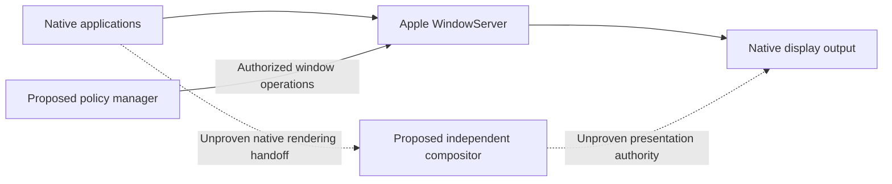

# wm-research

Research into a custom macOS window manager and native compositor on Apple Silicon, including the feasibility of replacing WindowServer while retaining compatibility with unmodified native applications.

**Status: research only — further validation required.** The repository contains ten reports, retained evidence, and a small SkyLight symbol-resolution probe. It does not contain an implemented window manager, compositor, or compatible WindowServer replacement.

```text
Architecture + local evidence
             |
             v
     Native rendering handoff  <-- next decisive research gate
             |
             v
 Independent composition + input + display ownership
                   (not demonstrated)
```

## Scope

The investigation covers macOS graphics responsibilities, private SkyLight APIs, WindowServer IPC and security boundaries, Core Animation/Metal rendering, IOSurface sharing, and display ownership. It compares existing macOS window managers and Linux compositors, proposes a modular system design, and defines experiments to test the missing capabilities.

The central distinction is between **controlling window policy** (layout, focus, workspaces) and **owning composition and presentation**. A manager that leaves rendering to WindowServer is a credible narrower direction, but does not fulfill the full compositor objective.



## Current status

The retained investigation is dated **2026-10-30**, targeting **macOS 27.0.1 (26A434), arm64, SDK 27.0**, with SIP enabled. This is an evidence baseline, not a supported-platform guarantee or a fresh validation on other builds.

| Area | Evidence and status |
|---|---|
| Architecture and service discovery | Reports and local launchd, binary, signing, and entitlement evidence are retained. |
| SkyLight exports | The isolated `dlopen`/`dlsym` probe resolves nine symbols. It does not call them or validate their ABI, behavior, or permissions. |
| Static binary inspection | REA/Hopper inspects the small WindowServer launcher. The cached SkyLight server implementation is not extracted or fully analyzed. |
| Cooperative surface sharing | IOSurface/Metal sharing is supported by SDK declarations and inspected source; no cross-process rendering experiment is completed. |
| Native client lifecycle and IPC | No live AppKit lifecycle trace, recovered wire schema, or compatible independent server is demonstrated. |
| Independent native composition | Surface intake for arbitrary unmodified applications, synchronization, input routing, and final display ownership remain unresolved. |
| Implementation and performance | System design and experiments are proposals. No compositor implementation or performance benchmarks are present. |

**Current conclusion:** further research is required. An advanced SkyLight-based manager is a plausible interim track only if retaining Apple's composition and presentation is accepted as the product scope. Full replacement remains a hypothesis, not a demonstrated capability or a proven impossibility.

Reports distinguish `CONFIRMED`, `STRONGLY SUPPORTED`, `HYPOTHESIS`, and `UNKNOWN`. Confirmation applies to the stated observation: an available export or source declaration does not establish working end-to-end compatibility.

## Implementation roadmap

The [master TODO](todo/MASTER_TODO.md) defines gated phases toward a custom native window server, from a recoverable UTM macOS lab through protocol discovery, rendering/input integration, and guest-session replacement. The [VM lab runbook](todo/VM_LAB.md) records future CLI steps and recovery requirements. Both are planning documents; VM setup and implementation remain pending.

## Next research gate

The first decisive experiment is to trace an **owned minimal AppKit client** through connection establishment, window creation, its first layer-backed update, and Metal drawable presentation. The goal is to identify resource and port handoff, context identity, synchronization, and lifetime obligations.

Subsequent gates cover native surface redirection, an isolated protocol server, and separate display/session ownership. A cooperative IOSurface demonstration alone does not prove compatibility with unmodified applications. See the [experimental validation plan](research/09-experimental-validation-plan.md) for procedures and acceptance criteria.

The documented experiments avoid attaching to WindowServer or Dock, replacing production services, disabling SIP, or changing protected files. More invasive work requires a separately authorized isolated lab plan.

## Research map

Start with the [executive conclusions](research/10-executive-conclusions.md), then use the detailed reports:

| Report | Subject |
|---|---|
| [01 — Graphics architecture](research/01-macos-graphics-architecture.md) | Framework responsibilities and verified boundaries |
| [02 — SkyLight APIs](research/02-skylight-api-analysis.md) | Export discovery, ABI leads, and inspection limits |
| [03 — WindowServer IPC](research/03-windowserver-ipc.md) | Service topology and unresolved protocol contracts |
| [04 — Surface rendering](research/04-surface-rendering-pipeline.md) | Sharing, synchronization, and native surface access |
| [05 — Replacement feasibility](research/05-windowserver-replacement-feasibility.md) | Security, session, and display constraints |
| [06 — Existing projects](research/06-existing-projects-review.md) | Source-based comparison of managers and compositors |
| [07 — Architecture comparison](research/07-architecture-comparison.md) | Policy, private API, composition, and replacement options |
| [08 — Proposed design](research/08-proposed-system-design.md) | Modules, contracts, and staged implementation gates |
| [09 — Validation plan](research/09-experimental-validation-plan.md) | Proposed experiments and acceptance criteria |
| [10 — Conclusions](research/10-executive-conclusions.md) | Findings, decision, and evidence needed to advance |

Raw artifacts live in [research/evidence/](research/evidence/), including the [probe source](research/evidence/skylight-symbols.c), [recorded probe output](research/evidence/skylight-symbols.txt), local service/binary evidence, SDK headers, and pinned upstream source excerpts. Architecture letters differ between the comparison and executive recommendation schemes; refer to the named architecture when reading across reports.

## External Software

Reading the reports requires only a Markdown viewer; Mermaid support is optional for diagrams. There is no application dependency manifest or product build/install workflow.

| Tool or source | Version / provenance | Role |
|---|---|---|
| Apple macOS and graphics frameworks | Recorded macOS 27.0.1 (26A434); SkyLight 600.0.0; SDK 27.0 | Investigation target and AppKit, CoreGraphics, QuartzCore, Metal, IOSurface, and display API evidence |
| Apple developer and system tools | Exact individual versions are not retained | C toolchain for the probe; `file`, `otool`, `nm`, `codesign`, and `launchctl` for the documented discovery workflow. LLDB is proposed for the next client-tracing experiment. |
| REA / Hopper Disassembler | REA workflow v1, workflow revision 3; Hopper launcher hash in [retained metadata](research/evidence/windowserver-rea.json), no semantic version recorded | Static launcher analysis |
| yabai, AeroSpace, SketchyBar, Darling, Smithay, wlroots, Hyprland | Pinned revisions in each project's `revision.txt` under [source evidence](research/evidence/projects/) | Comparative source evidence, not runtime dependencies; upstream links and limitations are in [report 06](research/06-existing-projects-review.md) |
| WebKit | Commit recorded in [webkit-commit.txt](research/evidence/surfaces/webkit-commit.txt) | Remote layer-tree, IOSurface, and private Core Animation interface evidence |
| Apple documentation, XNU, and Asahi Linux research | Source links and provenance in reports [01](research/01-macos-graphics-architecture.md), [03](research/03-windowserver-ipc.md), and [05](research/05-windowserver-replacement-feasibility.md) | Architecture, Mach substrate, and display-controller references; not implementation dependencies |

Rust and a narrow Objective-C/C bridge are proposed implementation choices, not an existing software stack.
