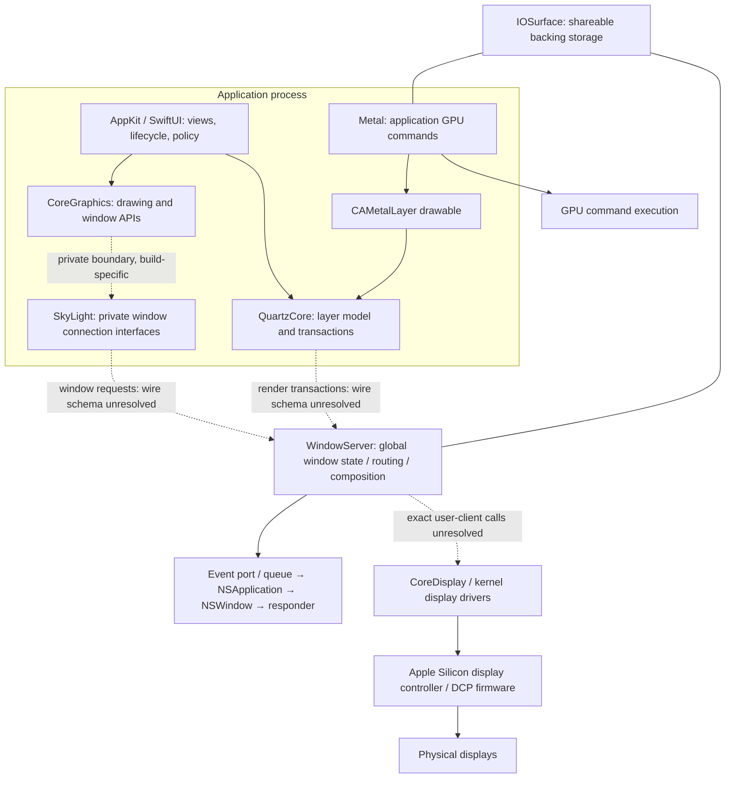

# macOS graphics architecture: verified boundaries

Target: local macOS 27.0.1 (26A434), arm64; SDK 27.0. Investigation date 2026-10-30. This is an architecture reconstruction, not a successful replacement experiment. CONFIRMED means source/API evidence where explicitly indicated; it does not imply execution on this build. STRONGLY SUPPORTED means converging architectural evidence; HYPOTHESIS and UNKNOWN remain unproved. See reports 02–05 for local binaries and security.

## Corrected model

Solid arrows represent documented API relationships or explicit source structure; dashed arrows mark a responsibility boundary whose current private transport is not reconstructed. IOSurface is backing storage, not a compositor and not a mandatory intermediate for every graphics operation. Metal commands go to GPU infrastructure; they do not all pass through SkyLight. Core Animation and SkyLight are related boundaries, not synonymous frameworks. CPU drawing, layer trees, GPU execution and display scanout have different owners.

## Responsibility and evidence ledger

| Question | Finding | Status / evidence |
|---|---|---|
| SkyLight responsibility | Connection/window interfaces and private window operations; do not infer all rendering lives in its client stubs. | STRONGLY SUPPORTED; local interface report 02. |
| WindowServer responsibility | Global window/event routing and system composition. Precise division among its loaded frameworks, helper processes and driver services remains incomplete. | STRONGLY SUPPORTED; Apple event architecture plus local process report 05. |
| Client responsibilities | AppKit owns NSWindow/NSView objects and event dispatch; CA owns the client layer model; applications submit their own Metal GPU work. | CONFIRMED API architecture, sources below. |
| AppKit → server | An NSWindow has client-side state and server registration. Calling AppKit APIs is not equivalent to a single SkyLight message. Current private call chain and registration point are UNKNOWN until isolated-client tracing. | UNKNOWN exact build-specific sequence; do not treat conceptual lifecycle as trace. |
| CA updates | Transactions group layer mutations; rendering involves a render-server boundary. WebKit explicitly implements remote layer-tree transfer and reconstructs CALayers. | CONFIRMED source; WebKit IPC is its own protocol, not Apple's server wire format. |
| Metal surfaces | CAMetalLayer vends drawables; present submits a drawable to Core Animation. GPU work completion and drawable availability govern reuse. | CONFIRMED Apple API; exact WindowServer buffer messaging UNKNOWN. |
| IOSurface sharing | A Mach send right can transfer access; the receiver imports a retained IOSurface. Buffer lifetime and frame synchronization are separate. | CONFIRMED SDK; report 04. |
| Display subsystem | A hardware/display-driver path exists beyond compositing; Apple Silicon uses DCP/DCPEXT controllers. Current CoreDisplay→driver selectors and authorization UNKNOWN. | CONFIRMED hardware research, not proof of third-party macOS access. |
| Input | Window server chooses recipient window; Cocoa receives via port and FIFO event queue, then dispatches through NSApplication/NSWindow. | CONFIRMED historical Apple documentation; current wire format UNKNOWN. |
| IDs | Window IDs, CGS connection IDs, CA context IDs and IOSurface IDs are distinct namespaces. WebKit CA SPI binds a context to a CGS connection and exposes contextId. | CONFIRMED declarations; universal mapping and access rules UNKNOWN. |

## Lifecycle: observed versus proposed

No live NSWindow lifecycle trace was performed in this report. The following is a trace plan, not an observation:

`NSApplication setup → connection establishment → NSWindow server registration → backing allocation → layer commit / drawable present → composition → scanout`.

Connection establishment may be lazy; window creation need not immediately allocate every backing; a window may own multiple layers and rotating buffers. Surface allocation and window registration therefore cannot safely be implemented as a one-window/one-buffer invariant. Verify by breakpoints in an owned debug AppKit client, recording thread, call stack, IDs and timestamps, without attaching to WindowServer. Even a successful minimal window trace excludes menus, IME, drag/drop, accessibility, color management, remote layers and fullscreen protocols.

## Direct sources

* [Apple Event Architecture](https://developer.apple.com/library/archive/documentation/Cocoa/Conceptual/EventOverview/EventArchitecture/EventArchitecture.html): event port, queue, dispatch architecture. Historical documentation is architectural evidence, not a macOS 27 protocol specification.
* [Apple Metal drawables](https://developer.apple.com/library/archive/documentation/3DDrawing/Conceptual/MTLBestPracticesGuide/Drawables.html): CAMetalLayer drawable lifecycle.
* [Apple Core Animation pipeline slides](https://devstreaming-cdn.apple.com/videos/wwdc/2014/419xxli6f60a6bs/419/419_advanced_graphics_and_animation_performance.pdf): application/render-server separation; historical, not current serializer evidence.
* [WebKit RemoteLayerTreeHost.mm](https://github.com/WebKit/WebKit/blob/d05eb32f6fc000907483128650e715b82b9629cc/Source/WebKit/UIProcess/RemoteLayerTree/RemoteLayerTreeHost.mm): `applyDisplayOnlyImage`, `layerForID`, layer reconstruction. Local snapshot in evidence/surfaces.
* [WebKit QuartzCoreSPI.h](https://github.com/WebKit/WebKit/blob/d05eb32f6fc000907483128650e715b82b9629cc/Source/WebCore/PAL/pal/spi/cocoa/QuartzCoreSPI.h#L86): `contextWithCGSConnection:options:`, `contextId`, fence methods, `CALayerHost`.
* [Asahi display controller research](https://asahilinux.org/docs/hw/soc/display-controllers/): hardware topology. Linux driver feasibility does not establish access under running macOS.
