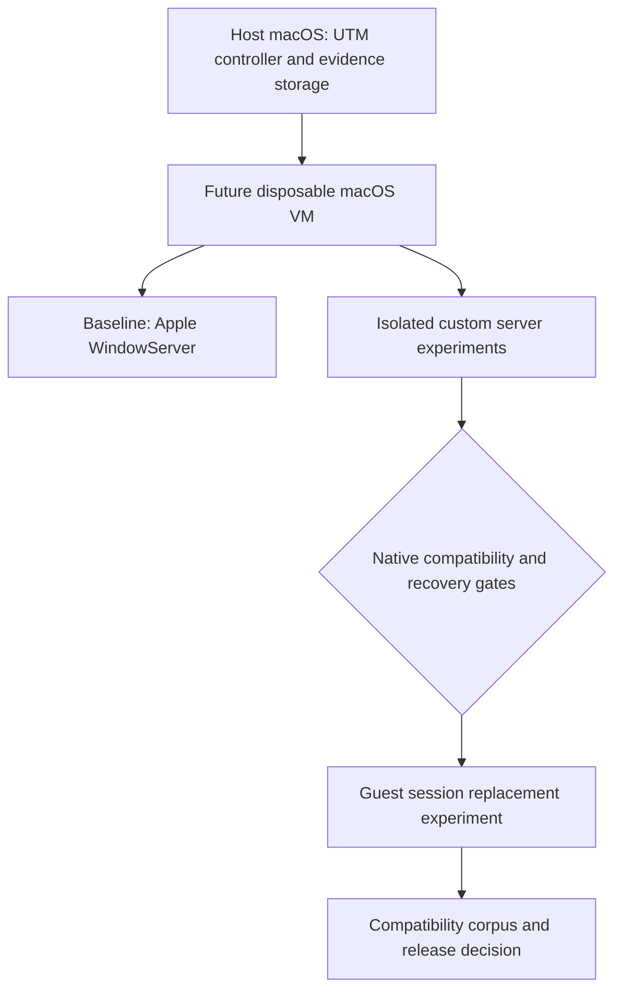

# Master TODO — Custom macOS window server

Status: **RESEARCH / PLANNING ONLY**. All execution phases below are pending. Creating, starting, or changing a VM is outside the current task. This plan does not establish that native WindowServer replacement is feasible.

## Intent and success criteria

Build a custom window server for native macOS applications, using a disposable macOS guest in UTM as the first integration environment. Preserve the distinction between a window policy manager, a nested compositor, and a server that owns the guest's native window/rendering path.

The first replacement milestone requires an owned application using unmodified AppKit/QuartzCore/Metal frameworks to connect, create a window, present changing content, receive input, resize, and disconnect against the custom server. Evidence must exclude fallback to Apple's guest WindowServer for the claimed operations. Broader application compatibility follows as a separate gate.

```text
P0 scope → P1 recoverable VM lab → P2 guest baseline → P3 native tracing
                                                         |
                     P4 isolated protocol server ←-------+
                                  |
                     P5 cooperative renderer control
                                  |
                     P6 native rendering integration
                                  |
                     P7 input + window policy
                                  |
                     P8 guest display/session replacement
                                  |
                     P9 compatibility → P10 release decision
```



## Constraints and decisions

- Host WindowServer, host security settings, and host login services remain outside the experiment scope.
- Use an Apple Silicon macOS guest with UTM's Apple Virtualization backend; select the exact supported host/guest combination in P1.
- Treat the existing macOS 27.0.1 (26A434) research as historical input. Discover guest APIs and binaries again; never assume host and guest identities match.
- Proposed implementation: Rust policy/protocol/resource core with a narrow Objective-C/C bridge and Metal renderer. Pin toolchain versions when implementation begins.
- Keep native compatibility, rendering, input, and presentation behind separate interfaces. A guest virtual display is not physical Apple Silicon display hardware.
- Keep SIP enabled for baseline work. Any later guest security/session changes need a concrete reviewed experiment and rollback procedure; this plan does not authorize them.
- Do not silently substitute a tiling manager or screen-capture compositor for the replacement objective. Such a scope change needs an explicit decision.

## Research findings informing the plan

- Existing reports establish export availability and architectural leads, not native protocol compatibility: [executive conclusions](../research/10-executive-conclusions.md).
- `utmctl` is installed at `/opt/homebrew/bin/utmctl`. Its help was inspected on 2026-10-30; VM inventory, UTM runtime version, and guest readiness have not been checked.
- UTM supports macOS guests on Apple Silicon and documents OS-dependent feature limits. Snapshot/disposable support must be checked against the actual installation before use: [macOS guest documentation](https://docs.getutm.app/guest-support/macos/).
- UTM exposes CLI lifecycle commands; guest execution/file operations require a guest agent. SSH is the planned fallback, subject to a guest connectivity test: [scripting documentation](https://docs.getutm.app/scripting/scripting/).
- Local CLI help says bare `utmctl stop` defaults to forced power-off. Planned normal shutdown uses `stop --request`, followed by status verification.

## Phase tracker

Every phase starts **PENDING**. Mark a phase complete only with linked evidence for its exit gate. Use `IN_PROGRESS`, `PASS`, `FAIL`, or `BLOCKED` for execution status; use `UNVERIFIED` for individual claims lacking evidence. A failed gate blocks dependent phases.

| Phase | Deliverable | Dependencies | Status |
|---|---|---|---|
| P0 | Scope and acceptance contract | None | PENDING |
| P1 | Recoverable UTM macOS lab | P0 | PENDING |
| P2 | Guest graphics/capability baseline | P1 | PENDING |
| P3 | Native lifecycle and protocol evidence | P2 | PENDING |
| P4 | Isolated server and native connection proof | P3 | PENDING |
| P5 | Cooperative surface renderer control | P2; P4 before integration | PENDING |
| P6 | Native rendering integration | P3–P5 | PENDING |
| P7 | Input, focus, and window policy | P6 | PENDING |
| P8 | Guest display/session replacement | P7 | PENDING |
| P9 | Compatibility and reliability corpus | P8 | PENDING |
| P10 | Versioned experimental release decision | P9 | PENDING |

## P0 — Freeze scope and acceptance contract

- [ ] Choose the initial guest OS/build and owned AppKit test client; record supported and excluded features.
- [ ] Define the first compatibility target: one window, changing content, resize, pointer/keyboard focus, close, and client/server failure handling.
- [ ] Define evidence required to distinguish synthetic clients, cooperative clients, unmodified framework clients, and third-party applications.
- [ ] Set lab resource limits, experiment timeouts, and criteria for stopping on instability.

**Exit gate:** a reviewed target contract with measurable success criteria. No claim of general macOS compatibility.

## P1 — Establish a recoverable UTM macOS lab

- [ ] Follow the [VM lab runbook](VM_LAB.md) to inventory UTM and select or provision a dedicated guest when execution is authorized.
- [ ] Record host/guest builds, UTM version/backend, VM UUID, CPU/RAM/disk settings, and installer provenance.
- [ ] Establish an ordinary guest account, developer tools, a logged-in GUI session, and independent SSH access for logs/recovery. Verify GUI and SSH execution contexts separately.
- [ ] Keep a stopped clean baseline and use a working clone. Verify snapshot support before choosing it as a rollback mechanism.
- [ ] Prove recovery by making a harmless marker change in a disposable clone and restoring the baseline; verify expected data loss and subsequent boot/login.
- [ ] Restrict shared directories to an experiment exchange directory; keep credentials and unrelated host data out of the guest.

**Exit gate:** repeatable boot, GUI access, artifact transfer, clean shutdown, and demonstrated restore. CLI presence alone is insufficient.

## P2 — Record the guest graphics and capability baseline

- [ ] Capture guest OS/SDK/build, service topology, signing/security state, relevant binary UUIDs/hashes, and available Metal devices.
- [ ] Repeat symbol discovery in the guest without invoking unknown signatures or mutators.
- [ ] Run an owned AppKit/CA/Metal baseline against Apple's guest server and record expected pixels, lifecycle events, and errors.
- [ ] Probe IOSurface sharing, synchronization primitives, virtual display behavior, and debugger access on the actual guest.
- [ ] Define run manifests and evidence directories before collecting results.

**Exit gate:** reproducible baseline and capability matrix with unsupported/unknown items explicit. If required GPU capabilities are absent, block GPU-dependent phases instead of accepting a different rendering path as equivalent.

## P3 — Recover native lifecycle and protocol boundaries

Start with [E01 — Owned AppKit window lifecycle trace](FIRST_EXPERIMENT.md), a bounded experiment specification with automation responsibilities and evidence criteria. Its completion is only part of the P3 gate.

- [ ] Trace only the owned client: initialization, connection, create, first commit/present, resize, and destruction.
- [ ] Inspect matching guest cache images/stubs; record ABI provenance before interpreting arguments.
- [ ] Identify endpoint lookups, message families, port-right ownership, notifications, context/resource identities, and ready/release synchronization.
- [ ] Repeat controlled traces to separate stable fields from per-run identifiers; retain a no-window baseline.
- [ ] Document unknowns and version-specific protocol fixtures. Do not infer wire layouts directly from API declarations.

**Exit gate:** validated request/reply and resource-lifetime evidence for the selected lifecycle, plus a concrete isolated routing mechanism. If routing is unresolved, P4 stays blocked.

## P4 — Implement an isolated protocol server

- [ ] Define transport, connection generation, object identity, request validation, event delivery, and disconnect contracts.
- [ ] Implement a minimal service in an isolated guest namespace; validate transport with a synthetic client first.
- [ ] Add only protocol families established in P3; fail unsupported operations explicitly.
- [ ] Route the owned native-framework client to the experimental service without overriding the active guest session's production endpoints.
- [ ] Trace all service dependencies and prove that claimed operations do not fall back to Apple's guest WindowServer.
- [ ] Exercise malformed requests, stale handles, dropped rights, client exit, and server restart.

**Exit gate:** native framework connection/window-lifecycle subset against the isolated service. A synthetic client pass does not satisfy this gate. If namespace isolation is impossible, stop and review a separate guest-session experiment before proceeding.

## P5 — Validate cooperative rendering mechanics

- [ ] Implement an owned IOSurface producer/consumer control experiment, with explicit acquire/release and GPU completion handling.
- [ ] Define `SurfaceLease`: producer/generation, dimensions/format/color space, damage, ownership, readiness, release obligation, and bounded queue behavior.
- [ ] Implement Metal composition with nested native output as a diagnostic backend.
- [ ] Validate frame IDs/pixels, resize, occlusion, buffer reuse, producer failure, and cleanup; begin with serialized synchronization.

**Exit gate:** correct shared frames and bounded resource lifetime. Label output **nested/cooperative**; it proves neither arbitrary native surface intake nor independent presentation.

## P6 — Integrate native rendering submissions

- [ ] Connect the recovered CA/Metal resource path to typed leases and scene state.
- [ ] Account for multi-layer/context content, transaction ordering, fences, damage, scale, color, resize, and occlusion.
- [ ] Demonstrate continuously changing native content without capture-only substitution or cooperative export changes to the compatibility client.
- [ ] Identify and suppress original presentation without stalling the producer; prove no duplicate presentation for the target case.
- [ ] Separate unsupported layer/video/protected-content cases from successful coverage.

**Exit gate:** the native test client renders correctly through the independent scene/compositor with trace and pixel evidence. Nested output may remain diagnostic; final presentation ownership remains P8.

## P7 — Add input and window-management semantics

- [ ] Implement geometry, ordering, lifecycle observations, focus, and normalized input events with explicit ownership/generation.
- [ ] Add coordinate transforms, hit testing, keyboard layouts, focus transfer, and cancellation on disconnect.
- [ ] Test multiple windows, overlap, resize, application exit, and recovery; evaluate IME, accessibility, drag/drop, grabs, and secure input as separate capabilities.
- [ ] Keep policy deterministic and independent of private ABI details; report applied, denied, unsupported, stale, and failed actions.

**Exit gate:** correct window/input behavior for the frozen P0 corpus, with unsupported features recorded rather than silently approximated.

## P8 — Test guest display and session replacement

- [ ] Identify an authorized guest virtual-display presentation path, device access requirements, and session/bootstrap dependencies.
- [ ] Write the exact guest-only takeover and rollback procedure, with SSH recovery, timeout/watchdog, preflight identity checks, and an untouched baseline.
- [ ] Review concrete guest security changes separately before applying them; never copy them to the host.
- [ ] Prove startup, frame presentation, input, server crash handling, and return to the baseline guest session.
- [ ] Verify no Apple guest WindowServer dependence for claimed composition/presentation; document any retained Apple service and its role.

**Exit gate:** repeatable custom guest session serving the target native client with independently controlled guest presentation and demonstrated recovery. A fullscreen Metal window inside Apple's desktop cannot pass. If unavailable, report the replacement objective blocked, with any nested/hybrid result labeled separately.

## P9 — Expand compatibility and measure reliability

- [ ] Add AppKit, SwiftUI, Metal, Electron, and Qt cases incrementally; record exact application/toolkit versions.
- [ ] Cover menus/dialogs, multiple windows, fullscreen, video, scale/color, accessibility, IME, and display changes where the VM supports them.
- [ ] Exercise disconnects, malformed traffic, crash loops, memory/rights leaks, resource limits, and guest reboot recovery.
- [ ] Compare correctness and performance against Apple's guest baseline using the same VM configuration and workloads.
- [ ] Keep debugger traces separate from timing runs; publish raw samples, variation, limitations, and failures.

**Exit gate:** reproducible compatibility matrix and bounded reliability/performance evidence. VM timing does not establish bare-metal performance or physical display compatibility.

## P10 — Decide release scope and hardware research

- [ ] Publish a versioned experimental artifact with build instructions, source revision, checksums, guest requirements, capabilities, and recovery instructions.
- [ ] Re-run acceptance from a fresh working clone using documented steps.
- [ ] Decide whether evidence supports a guest-only replacement, a narrower hybrid, or continued research.
- [ ] Define a separate hardware validation plan for physical display access, modes, HDR, hotplug, power transitions, and recovery before any host deployment proposal.

**Exit gate:** reviewed experimental release decision matching proven capability. Host installation and physical display takeover are separate future work.

## Mandatory validation and evidence contract

Tests are requirements for future execution; none are run by writing this plan.

- **Unit:** protocol parsing/validation, object generations, policy transitions, coordinate mapping, and resource-state machines as implemented.
- **Integration:** Mach rights and events, surface synchronization, disconnect/reconnect, GUI-session routing, and bounded cleanup inside the guest.
- **End-to-end:** native window creation, changing pixels, input, resize, shutdown, failure recovery, and exclusion of native-server fallback at the relevant gates.
- **Recovery:** restore a disposable guest before takeover work; preserve evidence outside the guest before rollback.

For each run retain `research/evidence/vm/<run-id>/` (future directory): manifest, source revision and dirty state, host/guest/UTM identities, security/capability state, exact commands, timestamps, exit codes, traces, expected/actual results, and recovery outcome. Avoid secrets and unrelated application data. Every phase result links its evidence and states `PASS`, `FAIL`, or `UNVERIFIED`; screenshots alone do not prove protocol or presentation ownership.

## Critical review and stop conditions

| Risk / unresolved assumption | Mitigation and stop condition |
|---|---|
| VM creation mistaken for feasibility proof | P1 only establishes a recoverable lab; require independent native protocol and display gates. |
| VM lacks required Metal/display capabilities | Probe P2; block dependent work and reassess the lab without inventing hardware equivalence. |
| Guest exec or snapshots unavailable | Verify actual backend support; use tested SSH and stopped-baseline cloning as alternatives. |
| Native clients require unrecovered services | Inventory dependencies; stop at missing contracts instead of fabricating success responses. |
| GUI process launched in wrong session | Record launch/session identity; do not assume SSH execution creates a usable GUI context. |
| Guest takeover loses GUI or network | Prove restore first; bound experiments and preserve an external recovery route. |
| Private ABI changes across builds | Bind adapters/fixtures to exact builds; reject unsupported versions. |
| Scope expands before a causal proof | Keep the first client/window small; expand compatibility only after the relevant gate passes. |

## Execution boundary

This document completes planning only. VM setup, code implementation, builds, tests, and session changes have not started. The next execution request should identify the phase to begin; later phases remain dependent on recorded acceptance gates.
